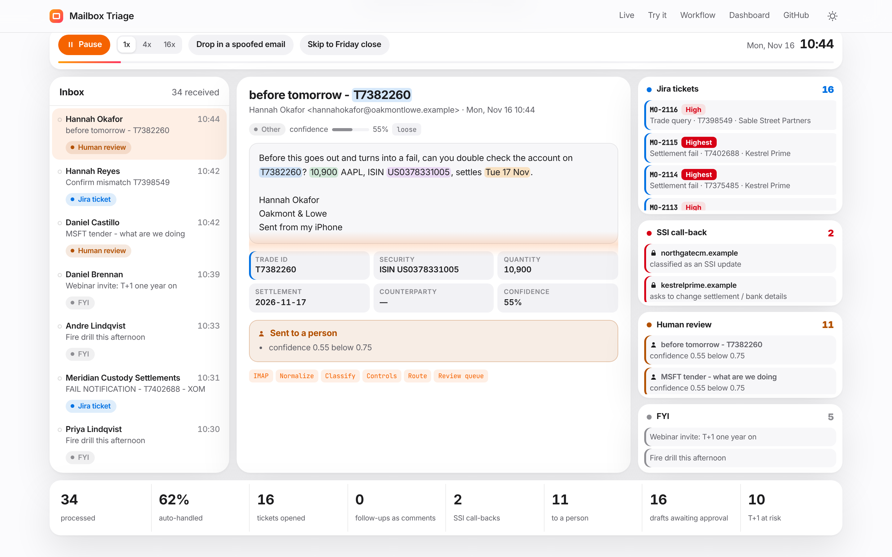

# mailbox-triage

An n8n workflow for a middle-office shared mailbox. Every email is read by an LLM and sorted: trade query, settlement fail, SSI update, corporate action election, price challenge, or noise. The trade ID, CUSIP/ISIN, quantity and settlement date go into structured JSON. Then the email either becomes a Jira ticket prioritised for T+1, or goes somewhere safer.

**Live demo: [rahu378.github.io/mailbox-triage](https://rahu378.github.io/mailbox-triage/)**

On the demo you can replay a week of mail, paste your own email (the Python pipeline runs in your browser), approve drafts, and click through the actual n8n workflow.



## What happens to an email

```
IMAP -> normalise -> OpenAI (one call, strict JSON schema) -> controls -> one of:

  Jira           ticket in MO, priority from business days to settlement, one open ticket per trade
                 (follow-ups become comments), reply drafted and parked as PENDING_APPROVAL
  SSI call-back  anything that could change where money or securities go
  Human review   model unsure, or the extracted facts don't check out
  FYI            out-of-office, newsletters, "thanks, all good"
```

## The controls

This is the part that matters more than the classifier.

- **SSI changes are never actioned from an email.** They go to a call-back queue, and static data rings the counterparty on the number *already on file*. The check runs first and nothing downstream can undo it. It fires on any of: the model's category, the model's `ssi_change_detected` flag, a regex second opinion that runs whatever the model says (it catches "please note our new account number" tacked onto the end of a trade query), or a sender domain one or two edits away from a known counterparty (`ha1den-sec.example`).
- **Confidence floor.** Below 0.75 the email goes to a person. So does anything whose fields fail validation: CUSIP or ISIN check digits, a settlement date that isn't a business day or is more than 10 business days out, a fail notice without a trade ID.
- **T+1 priority** comes from business days between receipt and settlement, on a calendar that knows Thursday 26 Nov 2026 is Thanksgiving (a Wednesday trade settles Friday). Settling today or already past due is Highest, T+1 is High, T+2 is Medium. Fails never go below High.
- **Replies are drafted, never sent.** Drafts sit as `PENDING_APPROVAL` until the approval webhook moves them. The database has a CHECK constraint that refuses `APPROVED`/`SENT` without an approver, so a bug in the workflow can't send mail.
- **One ticket per trade.** Follow-ups find the open ticket through a `ref-<trade or security>` label and become comments.

## Numbers

A synthetic week: 420 emails, Mon 16 to Fri 20 Nov 2026, with ground truth (`python -m triage.mailbox`). About one in five is written the way people actually type when they're busy, and about one in ten is deliberately awkward: forwards, an out-of-office quoting a fail notice, bank details hidden in a trade query, look-alike domains, a mistyped CUSIP.

Rules baseline (no API key needed, `python -m triage.benchmark`):

| | |
|---|---|
| Category accuracy | 341 / 420 (81.2%) |
| well-formed emails | 292 / 292 (100%) |
| the deliberately awkward ones | 40 / 40 (100%) |
| loosely worded | 9 / 88 (10%) |
| **Misrouted** | **0**. Every miss was caught by the confidence floor and went to a person |
| SSI changes routed to call-back | **41 / 41**, 0 false alarms |
| Priority on correctly opened tickets | 246 / 246 |
| Trade ID / CUSIP-ISIN / quantity / settlement date | 100% / 100% / 92.8% / 96.1% |

That 10% on loosely worded mail is the point. Keyword rules are perfect on well-formed mail and fall apart on "We couldn't deliver the META on 11/18, still waiting on our borrow." That's why the LLM does the reading. The rules stay underneath as the safety net, and they're what decides whether anything can be trusted.

Same harness with the model: `OPENAI_API_KEY=... python -m triage.benchmark --extractor openai`.

## n8n

- `n8n/mailbox_triage.json` and `n8n/reply_approval.json` import straight into n8n (tested on 2.49.6). Map the credentials (IMAP, OpenAI, Jira Cloud, Postgres, SMTP, plus a header-auth token for the approval webhook) and set your Jira site in the "Build Jira payload" node. n8n 2.x blocks `$env` in nodes by default, so that setting lives there.
- The Code-node logic lives in `n8n/code/*.js`. `controls.js` is the JavaScript twin of `triage/controls.py`, and `n8n/code/*.test.js` checks it makes the same call as Python on all 420 emails (route, priority, validation errors, SSI flags). The workflow test runs the Code nodes from the *generated* JSON in an emulation of n8n's runtime.
- `python n8n/build.py` assembles the workflow JSON from those files, the prompt and the output schema. A test fails if the committed JSON is stale.

**Run in a real n8n** (`n8n/e2e/run_e2e.sh`). The production workflow runs in n8n 2.49.6 against Postgres 16, with OpenAI and Jira swapped for local mocks. Only the trigger and the outbound mail are swapped; every other node is the production one.

| | |
|---|---|
| first run, 420 emails | routes match the Python pipeline exactly (Jira 246, review 81, FYI 52, SSI 41), 246 drafts pending |
| same mailbox again | 246 follow-ups became comments, 0 new tickets, still exactly 420 rows (idempotent) |
| approval workflow | 3 drafts moved to SENT with approver and timestamp, an unknown ID changed nothing |

That run caught a real bug the unit tests couldn't. The first version routed *after* the Postgres insert and looked items up with `$('Parse + controls').item`. With many items, n8n can't pair items back through a Postgres node ("Multiple matches found"). Now the route comes straight off the controls node, the save runs as a parallel branch placed above it (v1 execution order writes the parent row first), and every branch reads its own input.

## Data and reporting

- `sql/schema.sql`: emails, triage results (with reasons and flags), Jira tickets, the SSI call-back queue, the review queue, reply drafts, audit log. `sql/views.sql`: the `vw_*` views the Power BI report reads.
- `powerbi/`: DAX measures, report theme, model and page layout. The dashboard on the demo site is a web version of the same pages.

## Run it

```bash
pip install -r requirements.txt
python -m triage.mailbox        # data/mailbox.jsonl + labels
python -m triage.benchmark      # rules baseline
python -m pytest -q             # includes the n8n parity tests if node is installed
python n8n/build.py             # rebuild the workflow JSON after editing n8n/code or prompts
```

## Layout

```
triage/
  mailbox.py      synthetic mailbox with ground truth
  extract.py      rules extractor + OpenAI structured-output extractor (+ check digits, SSI detector)
  controls.py     validation, SSI call-back, confidence floor, T+1 priority
  calendar.py     US settlement calendar
  jira.py         Jira Cloud v3 payloads (ADF), dedupe, client with a dry-run mode
  drafts.py       reply drafts (never for SSI or review items)
  pipeline.py     the Python twin of the n8n workflow
  store.py        Postgres/SQLite persistence, draft approval
  benchmark.py    scoring against the labels
n8n/              workflows, Code-node sources + tests, build script, e2e harness
prompts/          system prompts for triage and drafting
sql/              schema and reporting views
powerbi/          measures, theme, model notes
docs/             GitHub Pages site
```

## Notes

- Within one IMAP poll, n8n runs every Jira lookup before any create, so two emails about the same trade in the *same* poll make two tickets. Across polls it de-dupes, which is what the second e2e run shows. At our volumes that's fine. A Loop Over Items node would close the gap if it isn't.
- The prompt says "Thursday 26 Nov 2026 is a holiday" because the model resolves "tomorrow" too. The controls recompute priority from the calendar anyway.
- Next: run the OpenAI benchmark and compare its loose-email accuracy with the rules, add a confidence-calibration plot, and push the SSI call-back outcome back onto the Jira ticket.
